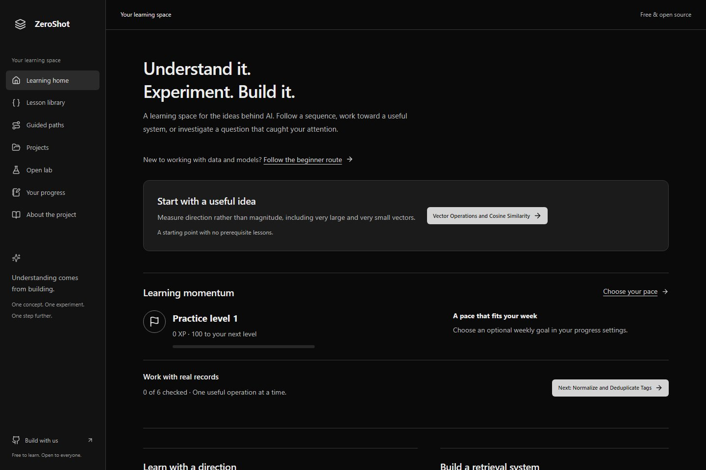
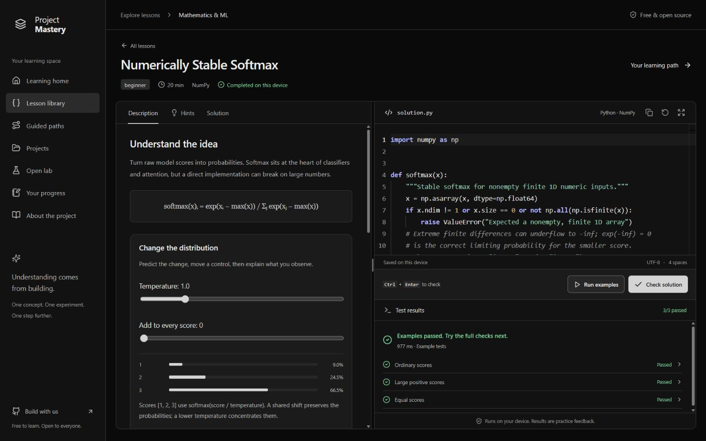

# ZeroShot

Free, open-source AI learning for Python programmers. Follow connected paths, investigate interactive experiments, or start with a retrieval project and learn the concepts as you build.

The current curriculum contains 450 lessons, including 205 beginner lessons, 4 interactive experiments, and a retrieval project with a Python integration checkpoint. The [450-question expansion](docs/curriculum-450.md) adds 250 distinct activities, including 195 substantive beginner lessons. Start with the beginner route or filter the library by difficulty. Each lesson includes worked examples, hints, a reference implementation, and runnable checks. Two existing lessons begin with deliberately flawed code to investigate and repair. The [2,000-problem curriculum plan](docs/curriculum.md) separates the expansion target from published content.

Optional learning momentum adds practice XP, skill milestones, chosen learning quests, and flexible weekly goals. Quiet mode hides the game layer. The [research and implementation plan](docs/research/gamification-evidence.md) explains the decisions; the [TrenTorch review](docs/research/trentorch-review-2026-10-31.md) records the reference study. Existing progress and Project Mastery backups remain compatible with ZeroShot.

The [retrieval project](docs/retrieval-project.md) compares keyword, BM25, vector,
and hybrid search. Inspect individual term scores, assemble evidence under a word
budget, and export the dataset, settings, results, and findings together.



The screenshot records the ZeroShot learning home with optional personal momentum. Coding lessons start with incomplete code or a clearly labelled debugging investigation. The current interface keeps the black/grey base and uses semantic colors for feedback and Python syntax.



This workspace screenshot shows an existing reference draft passing three example cases. Example-only runs do not record completion.

## Local setup

Requires Node.js 22+, pnpm 11.25.0, and Python 3.13+ with NumPy.

```sh
npm install -g pnpm@11.25.0
pnpm install
python -m pip install numpy
pnpm dev
```

Open http://localhost:3000. The separate runner uses http://127.0.0.1:4174. Keep both addresses distinct. The first setup downloads the pinned Python runtime and NumPy package; subsequent runs reuse them.

## Checks

```sh
pnpm check
pnpm exec playwright install chromium firefox webkit
pnpm test:e2e
```

The project is in development. See [verification](docs/verification.md) for what has actually been verified and [architecture](docs/architecture.md) for the execution boundary and limits. Browser results are practice feedback, not tamper-resistant certification.

For fast content iteration, use `pnpm content:check m05 d06 e07` (omit IDs for all packages). See the [free-resource survey and batch workflow](docs/source-research.md) and its [source registry](content/sources.json).

For larger authored batches, `pnpm content:author` generates draft packages and
source notices from one JSON file. The [production workflow](docs/content-production.md)
documents the reusable packager, 25–50-objective batch target, shared CI build and
parallel browser checks.

## Contributing and maintenance

Start with [CONTRIBUTING.md](CONTRIBUTING.md). Use a branch and pull request; GitHub Actions checks content, reference solutions, types, formatting, lint, builds, and Chromium/Firefox/WebKit behavior. Dependabot proposes weekly dependency and Actions updates. Report vulnerabilities privately using the repository's Security tab.

The [design record](DESIGN.md) describes the implemented palette, layout, controls, and responsive behavior. The [roadmap](docs/roadmap.md) tracks the remaining curriculum, account, and deployment work.

## Structure

- `apps/web`: Next.js learning workspace.
- `apps/runner`: sandbox frame and disposable Python workers on an isolated origin.
- `packages`: versioned problem schema and validated message protocol.
- `content/problems`: lesson statements, starter code, tests, reference solutions, and applicable source notices.
- `scripts`: validation, runtime preparation, and local development servers.
- `tests`: schema, evaluator, browser, and isolation checks.

Original software and Python additions: Apache-2.0. Original educational prose: CC BY-SA 4.0. Third-party material retains its applicable terms: the D2L filter adaptation preserves its [MIT-0 notice](content/problems/d09-image-cross-correlation/THIRD_PARTY_NOTICE.md), and 37 Pyre-Code adaptations retain full MIT notices in each package and browser reference. See LICENSE, content/LICENSE, [batch provenance](content/batch-03-provenance.json), [pilot provenance](content/platform-pilot-provenance.json), [second platform batch provenance](content/platform-batch-02-provenance.json), [third platform batch provenance](content/platform-batch-03-provenance.json), and [the D41–D47 adaptations](content/deep200-provenance.json).
